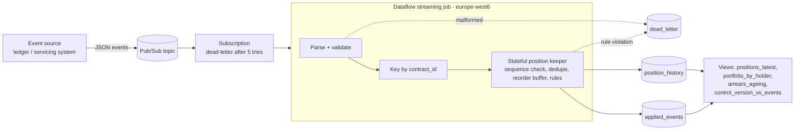

# Tokenized lease life-cycle on Google Cloud

A small reference implementation of the data backbone behind a tokenized leasing portfolio: lease tokens are issued, serviced, transferred and redeemed, and every state change flows through Pub/Sub, Dataflow (Apache Beam) and BigQuery.

It is a **demo on synthetic data**. It uses no client data, and it is not any company's production system. The scenario is inspired by public descriptions of leasing-contract tokenization for process automation, where each lease is a token and its payment schedule drives the life-cycle.

> Built with AI assistance (Claude). The author specified the scenario and reviewed the design; the code is covered by the tests below.

**[Watch the demo run (video, about 1 minute)](lease-demo-run.mp4)**: the tests, the pipeline run on messy input, dead letters, and the reconciliation result.

## What it shows

1. **Deterministic cash-flow schedule from contract terms.** An annuity with a residual value (`schedule.py`), in exact decimal arithmetic. This is ACTUS-inspired (every future event derives from the terms). It is not an ACTUS-conformant implementation.
2. **A single, framework-free definition of the business rules** (`ledger.py`): issue, payment received, payment missed, transfer, early termination, maturity. The same code runs inside the Beam job and inside the reconciliation.
3. **Messy-stream handling**: events arrive out of order, are delivered twice, break business rules, or are not valid JSON. The pipeline applies events per contract in sequence order, is idempotent on duplicates, buffers gaps, and routes bad input to a dead-letter table with a reason.
4. **Position keeping in a stateful Beam `DoFn`**, one state cell per contract, with every applied event producing a new versioned position row.
5. **An analytics layer in BigQuery** (`sql/views.sql`): latest position, exposure by holder, arrears ageing, and a control view that must always be empty.
6. **Reconciliation as a first-class feature.** The pipeline output is compared with an independent batch fold of the same input.

## Architecture



Design choices worth discussing:

- **Sequence numbers per contract** make the stream deterministic. Out-of-order events wait in a bounded buffer; duplicates are no-ops.
- **A rejected event consumes its sequence number**, so one bad event cannot block a contract forever. It is recorded in `dead_letter` with the reason.
- **Append-only history plus a "latest" view** gives an audit trail and cheap point-in-time queries, instead of in-place updates.
- **Region and encryption**: scripts default to `europe-west6` (Zurich) and accept a customer-managed key (`KMS_KEY`) for BigQuery and Dataflow.

## Run it locally

```bash
pip install -r requirements.txt
make demo     # generate data, run the Beam pipeline on the DirectRunner, reconcile, print a report
make test     # 18 tests
```

Sample output is in `docs/sample_output.txt`. The run processes 1,298 input lines (including duplicates, shuffled order, three malformed lines and five rule-breaking events) across 40 lease tokens and reconciles with zero differences.

## Deploy to Google Cloud (untested against a live project)

```bash
PROJECT=my-sandbox-project ./infra/setup.sh        # topic, subscription, dataset, tables, views, service account
PROJECT=my-sandbox-project ./infra/run_dataflow.sh # streaming Dataflow job
python infra/publish.py --project my-sandbox-project
```

These scripts were written and syntax-checked but **have not been run against a live GCP project**. Expect small fixes (organization policies, quotas, IAM propagation delay) on a first run.

## What is tested

| Area | How |
|---|---|
| Schedule maths | amortizes to the residual, principal plus interest equals payment, zero-rate case |
| State machine | each transition, rejections leave state unchanged, terminal states are final |
| Idempotency and ordering | duplicates are no-ops; 25 random shufflings converge to the same state; events before ISSUE are buffered |
| Pipeline | Beam DirectRunner output equals an independent reference fold; dead letters capture bad input |
| SQL | the views run on DuckDB against pipeline output; the control view returns zero rows |

## Limitations

- **The reference fold reuses the same business rules** (`ledger.step`) in a different execution path. It proves that Beam state handling, ordering, de-duplication and sinks do not change the result. The rules themselves are verified by the unit tests, not by the reconciliation.
- **No blockchain component.** The "token" is a ledger record. A real tokenization platform would feed this pipeline from a permissioned ledger or its event API, and would add key management, identity and settlement finality.
- **BigQuery streaming inserts** are used for simplicity. For exactly-once semantics at scale, use the Storage Write API.
- **State growth and stuck gaps**: the reorder buffer is bounded (1,000 events per contract) but there is no timer that escalates a gap that never fills. A production job would add one.
- **No schema evolution, backfill or replay tooling**, and no monitoring or alerting.
- Amounts use `Decimal` in Python and `NUMERIC` in BigQuery. There is no FX, interest accrual between due dates, or fees.

## Layout

```
src/lease_demo/   schedule.py  ledger.py  pipeline.py  generator.py  reference.py  report.py
sql/views.sql     BigQuery views and the reconciliation control
infra/            setup.sh  run_dataflow.sh  publish.py
tests/            core rules, Beam end to end, SQL on DuckDB
```
# Tokenized lease life-cycle on Google Cloud

A small reference implementation of the data backbone behind a tokenized leasing portfolio: lease tokens are issued, serviced, transferred and redeemed, and every state change flows through Pub/Sub, Dataflow (Apache Beam) and BigQuery.

It is a **demo on synthetic data**. It uses no client data, and it is not any company's production system. The scenario is inspired by public descriptions of leasing-contract tokenization for process automation, where each lease is a token and its payment schedule drives the life-cycle.

> Built with AI assistance (Claude). The author specified the scenario and reviewed the design; the code is covered by the tests below.

## What it shows

1. **Deterministic cash-flow schedule from contract terms.** An annuity with a residual value (`schedule.py`), in exact decimal arithmetic. This is ACTUS-inspired (every future event derives from the terms). It is not an ACTUS-conformant implementation.
2. **A single, framework-free definition of the business rules** (`ledger.py`): issue, payment received, payment missed, transfer, early termination, maturity. The same code runs inside the Beam job and inside the reconciliation.
3. **Messy-stream handling**: events arrive out of order, are delivered twice, break business rules, or are not valid JSON. The pipeline applies events per contract in sequence order, is idempotent on duplicates, buffers gaps, and routes bad input to a dead-letter table with a reason.
4. **Position keeping in a stateful Beam `DoFn`**, one state cell per contract, with every applied event producing a new versioned position row.
5. **An analytics layer in BigQuery** (`sql/views.sql`): latest position, exposure by holder, arrears ageing, and a control view that must always be empty.
6. **Reconciliation as a first-class feature.** The pipeline output is compared with an independent batch fold of the same input.

## Architecture


Design choices worth discussing:

- **Sequence numbers per contract** make the stream deterministic. Out-of-order events wait in a bounded buffer; duplicates are no-ops.
- **A rejected event consumes its sequence number**, so one bad event cannot block a contract forever. It is recorded in `dead_letter` with the reason.
- **Append-only history plus a "latest" view** gives an audit trail and cheap point-in-time queries, instead of in-place updates.
- **Region and encryption**: scripts default to `europe-west6` (Zurich) and accept a customer-managed key (`KMS_KEY`) for BigQuery and Dataflow.

## Run it locally

```bash
pip install -r requirements.txt
make demo     # generate data, run the Beam pipeline on the DirectRunner, reconcile, print a report
make test     # 18 tests
```

Sample output is in `docs/sample_output.txt`. The run processes 1,298 input lines (including duplicates, shuffled order, three malformed lines and five rule-breaking events) across 40 lease tokens and reconciles with zero differences.

## Deploy to Google Cloud (untested against a live project)

```bash
PROJECT=my-sandbox-project ./infra/setup.sh        # topic, subscription, dataset, tables, views, service account
PROJECT=my-sandbox-project ./infra/run_dataflow.sh # streaming Dataflow job
python infra/publish.py --project my-sandbox-project
```

These scripts were written and syntax-checked but **have not been run against a live GCP project**. Expect small fixes (organization policies, quotas, IAM propagation delay) on a first run.

## What is tested

| Area | How |
|---|---|
| Schedule maths | amortizes to the residual, principal plus interest equals payment, zero-rate case |
| State machine | each transition, rejections leave state unchanged, terminal states are final |
| Idempotency and ordering | duplicates are no-ops; 25 random shufflings converge to the same state; events before ISSUE are buffered |
| Pipeline | Beam DirectRunner output equals an independent reference fold; dead letters capture bad input |
| SQL | the views run on DuckDB against pipeline output; the control view returns zero rows |

## Limitations

- **The reference fold reuses the same business rules** (`ledger.step`) in a different execution path. It proves that Beam state handling, ordering, de-duplication and sinks do not change the result. The rules themselves are verified by the unit tests, not by the reconciliation.
- **No blockchain component.** The "token" is a ledger record. A real tokenization platform would feed this pipeline from a permissioned ledger or its event API, and would add key management, identity and settlement finality.
- **BigQuery streaming inserts** are used for simplicity. For exactly-once semantics at scale, use the Storage Write API.
- **State growth and stuck gaps**: the reorder buffer is bounded (1,000 events per contract) but there is no timer that escalates a gap that never fills. A production job would add one.
- **No schema evolution, backfill or replay tooling**, and no monitoring or alerting.
- Amounts use `Decimal` in Python and `NUMERIC` in BigQuery. There is no FX, interest accrual between due dates, or fees.

## Layout

```
src/lease_demo/   schedule.py  ledger.py  pipeline.py  generator.py  reference.py  report.py
sql/views.sql     BigQuery views and the reconciliation control
infra/            setup.sh  run_dataflow.sh  publish.py
tests/            core rules, Beam end to end, SQL on DuckDB
```
